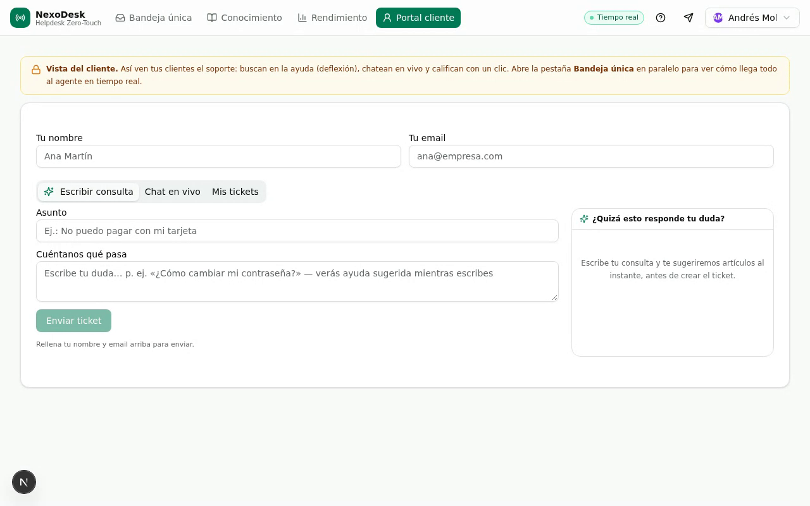
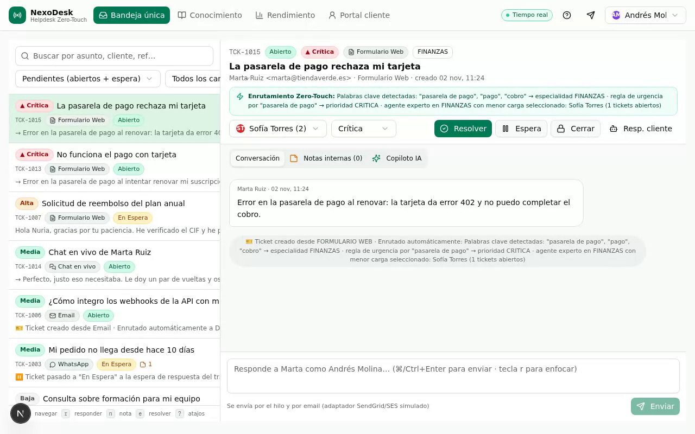

# NexoDesk · Helpdesk Zero-Touch

> **Bandeja única multicanal · Enrutamiento inteligente · Copiloto IA · Portal de cliente en tiempo real**

     

NexoDesk es un sistema de soporte (helpdesk) que convierte el caos de canales (email, formulario web, WhatsApp y chat en vivo) en **una sola bandeja priorizada**, automatiza la triaje con reglas **Zero-Touch** y ayuda al agente con un **Copiloto IA** que redacta respuestas a partir de la Base de Conocimiento.

| Portal del cliente | Bandeja única del agente |
|:---:|:---:|
|  |  |

▶️ **[Vídeo demo con narración · 10 s (MP4)](docs/media/nexodesk-demo-10s-con-audio.mp4)** · [versión sin audio](docs/media/nexodesk-demo-10s.mp4) · [GIF](docs/media/nexodesk-demo.gif)

*En el vídeo: el cliente describe un fallo en la pasarela de pago → sin intervención humana el ticket se crea, se marca **Crítica**, se enruta a **Finanzas** (especialista con menor carga) y aparece al instante en la bandeja del agente.*

---

## ✨ Qué incluye

- **Bandeja única** — los 4 canales (Email, Formulario Web, WhatsApp, Chat en vivo) en una sola lista ordenada por prioridad, con filtro por estado/agente y búsqueda.
- **Flujo de agente 100 % teclado** — estilo Gmail: `j/k` navegar, `r` responder, `e` resolver… sin tocar el ratón (tabla completa abajo).
- **Enrutamiento Zero-Touch** — clasifica categoría y prioridad por palabras clave (con normalización de acentos) y asigna al **especialista con menor carga abierta**, dejando la **razón de la decisión visible** en el ticket.
- **Copiloto IA** — lee el ticket, recupera los artículos relevantes de la KB y redacta un borrador con *«Fuentes usadas»*; el agente lo revisa y lo envía con un clic.
- **Deflexión de tickets** — mientras el cliente escribe en el formulario, la búsqueda semántica sugiere artículos: *«¿Quizás esto responde a tu duda?»* con porcentaje de coincidencia.
- **Chat en vivo** — Socket.io real: el mensaje del visitante **crea el ticket automáticamente** y salta en la bandeja del agente (toast + actualización en vivo).
- **Notas internas** — visibles solo para el equipo, nunca para el cliente.
- **CSAT automático** — al resolver (tecla `e`) se genera el email de encuesta de un clic **Feliz / Neutral / Triste** en la bandeja de salida simulada (adaptador listo para SendGrid / AWS SES).
- **Vista de Rendimiento** — KPIs en vivo: volumen, reparto por canal, tiempo de primera respuesta, carga por agente y deflexiones logradas.
- **Base de Conocimiento** — artículos públicos con buscador semántico propio (sin acentos, sinónimos, lemas ligeros) que responde en `<1 ms`.

## 🤖 Las tres automatizaciones Zero-Touch

| # | Automatización | Qué hace | Implementación |
|:-:|---|---|---|
| 1 | **Enrutamiento inteligente** | «Error en la pasarela de pago» → categoría *Finanzas* + prioridad *Crítica* + agente experto con menos tickets abiertos | [`src/lib/routing.ts`](src/lib/routing.ts) |
| 2 | **Copiloto de respuestas** | Ticket + búsqueda semántica en KB + LLM → borrador revisable con fuentes | [`src/lib/ai.ts`](src/lib/ai.ts) |
| 3 | **Deflexión con KB** | Sugerencias en el formulario mientras el cliente escribe (~40 % menos tickets repetidos) | [`src/lib/search.ts`](src/lib/search.ts) |

## 🧱 Stack

| Capa | Tecnología |
|---|---|
| Frontend | Next.js 16 (App Router) · React 19 · TypeScript · Tailwind CSS 4 · shadcn/ui |
| Datos | Prisma ORM · SQLite en desarrollo (esquema preparado para PostgreSQL + pgvector) |
| Tiempo real | Socket.io (mini-servicio dedicado) + gateway Caddy para WebSocket |
| Estado cliente | TanStack Query · Zustand |
| IA | z-ai-web-dev-sdk (el LLM solo se invoca en el backend) |
| Email | Bandeja de salida simulada (`EmailLog`) con adaptador para SendGrid / AWS SES |

## 🚀 Puesta en marcha

**Requisitos:** Node.js 20+ (o Bun 1.x). Para el tiempo real en local se usa [Caddy](https://caddyserver.com/) como gateway (opcional).

```bash
# 1) Dependencias
npm install                # o: bun install

# 2) Variables de entorno
cp .env.example .env

# 3) Base de datos (SQLite) + datos de demostración
npx prisma db push
npm run db:seed            # 5 agentes, 12 tickets, 38 mensajes, 9 artículos KB…

# 4) App principal  → http://localhost:3000
npm run dev

# 5) (Opcional) Tiempo real: mini-servicio Socket.io en :3003
npm run realtime
```

**Con tiempo real:** el navegador conecta el WebSocket a través del gateway, así que levanta Caddy y abre la app por él:

```bash
caddy run --config Caddyfile   # gateway en :81 → abre http://localhost:81
```

Sin Caddy la aplicación funciona igual (creación, bandeja, KB, CSAT…), solo verás el indicador «Tiempo real» en rojo.

## ⌨️ Atajos de teclado (bandeja)

| Tecla | Acción | Tecla | Acción |
|:-:|---|:-:|---|
| `j` / `↓` | Ticket siguiente | `a` | Asignar agente |
| `k` / `↑` | Ticket anterior | `p` | Cambiar prioridad |
| `r` | Responder (redactor) | `s` | Marcar *En Espera* |
| `n` | Nota interna | `e` | Resolver → envía CSAT |
| `i` | Conversación ↔ Notas | `c` | Cerrar ticket |
| `Enter` | Abrir detalle | `?` | Ayuda de atajos |
| `⌘/Ctrl + Enter` | Enviar redacción | `Esc` | Volver al modo comando |

## 🗂️ Estructura del proyecto

```
├── prisma/                    # schema.prisma + seed de datos demo
├── src/
│   ├── app/
│   │   ├── api/               # tickets, portal, kb, stats, emails, csat, agents…
│   │   └── page.tsx           # monta HelpdeskApp
│   ├── components/helpdesk/   # Inbox, TicketDetail, Portal, Dashboard, KB
│   ├── hooks/                 # useToast, use-mobile
│   └── lib/                   # routing · ai · search · constants · db · realtime
├── mini-services/realtime/    # mini-servicio Socket.io (puerto 3003)
├── Caddyfile                  # gateway :81 (WebSocket → Next + Socket.io)
└── docs/                      # arquitectura y media del README
```

## 🗺️ Roadmap

- [x] **MVP 1 — Bandeja única** con atajos de teclado (soporte@ + formulario en una sola lista)
- [x] **MVP 2 — CSAT** de un clic (Feliz / Neutral / Triste) al resolver
- [x] Zero-Touch: enrutamiento por carga/especialidad, Copiloto IA, deflexión con KB
- [x] Chat en vivo con creación automática de tickets (Socket.io)
- [ ] Integraciones reales: Twilio WhatsApp · SendGrid/SES con webhooks entrantes
- [ ] PostgreSQL + pgvector (embeddings reales para la búsqueda semántica)
- [ ] Gestión completa de la KB desde la UI (CRUD + versionado)
- [ ] Reportes avanzados y SLA configurables
- [ ] Autenticación multi-rol (agente / admin / cliente)

## 🤝 Contribuir

¡Bienvenidas las contribuciones! Lee [CONTRIBUTING.md](CONTRIBUTING.md) para la convención de commits y el flujo de trabajo. La interfaz está en **español de España** (`es-ES`).

## 📄 Licencia

[MIT](LICENSE) © Peiboll17
