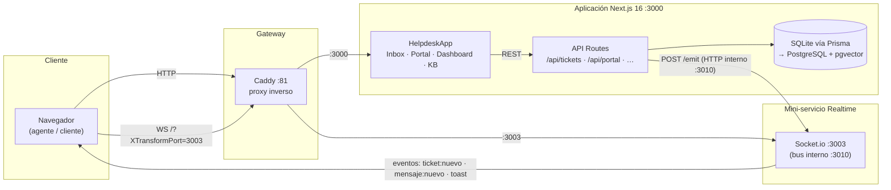
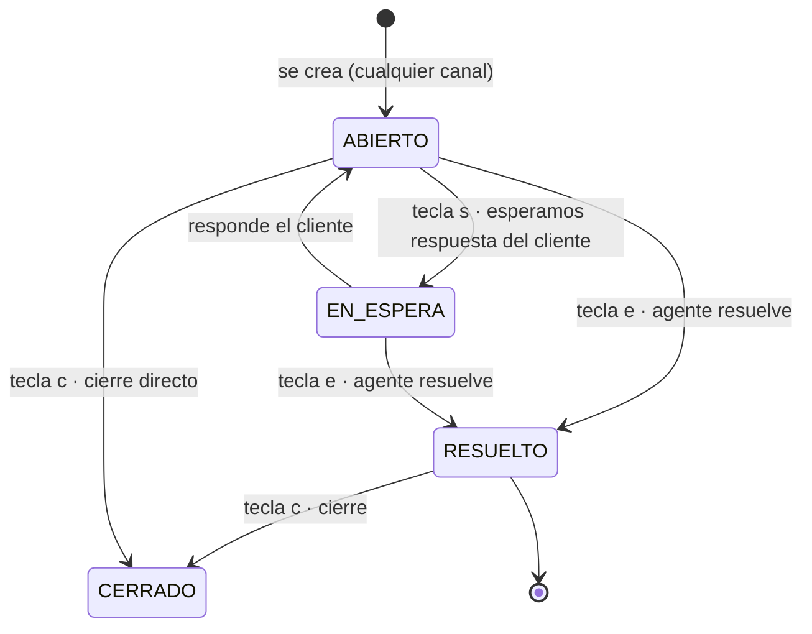

# Arquitectura de NexoDesk

Documento técnico del sistema: componentes, modelo de datos, máquina de estados, los tres flujos Zero-Touch, la API y el camino a producción.

## 1. Visión general de componentes

- **Todo el tráfico del navegador pasa por el gateway `:81`** (ver `Caddyfile`). La app en `:3000` y Socket.io en `:3003` no se exponen directamente.
- El backend emite eventos de tiempo real por **HTTP interno** (`src/lib/realtime.ts` → `REALTIME_URL`, por defecto `http://localhost:3010`); si el servicio no está disponible, la operación principal **nunca falla** por ello (degradación elegante).
- El navegador conecta el WebSocket del chat con la ruta `/?XTransformPort=3003` a través de Caddy.

## 2. Modelo de datos (Prisma)

| Modelo | Representa | Campos clave |
|---|---|---|
| `Ticket` | La unidad central | `ref` (TCK-1001), `status`, `priority`, `source`, `category`, `routingReason`, `assigneeId`, `firstResponseAt`, `csatScore` |
| `Message` | Hilo cliente ↔ agente | `authorType` (CUSTOMER / AGENT / SYSTEM), `body` |
| `InternalNote` | Notas internas del equipo | `authorName`, `body` — nunca se muestran al cliente |
| `KBArticle` | Artículos de ayuda / FAQ | `slug`, `tags`, `keywords`, `views` (deflexiones logradas) |
| `Agent` | Agentes de soporte | `specialties` ("finanzas,tecnico"), `isActive` |
| `EmailLog` | Bandeja de salida simulada | `kind` (TICKET_CREATED / AGENT_REPLY / CSAT_REQUEST / STATUS_CHANGE), adaptador SendGrid/SES |

Decisiones:

- **SQLite no soporta enums de Prisma** → se usan `String` + constantes tipadas en `src/lib/constants.ts` (`SOURCES`, `STATUSES`, `PRIORITIES`, `CATEGORIES`). Al migrar a PostgreSQL pueden convertirse a enums nativos sin cambiar el código cliente.
- `routingReason` guarda la **explicación legible** del motor de enrutamiento y se muestra en el ticket (transparencia del Zero-Touch).
- `visitorId` enlaza una sesión de chat en vivo con su ticket.

## 3. Máquina de estados del ticket

Al pasar a **RESUELTO** ocurren tres cosas automáticamente: se sella `resolvedAt`, se registra `firstResponseAt` si es la primera respuesta y se genera un `EmailLog` de tipo `CSAT_REQUEST` (encuesta Feliz / Neutral / Triste de un clic).

## 4. Los tres flujos Zero-Touch

### 4.1 Enrutamiento inteligente (`src/lib/routing.ts`)

1. Se normaliza el texto (minúsculas, sin acentos): *«contraseña» → «contrasena»*.
2. Cada regla (`FINANZAS`, `TECNICO`, `CUENTAS`) puntúa por las palabras clave encontradas — pesan más las más específicas (longitud).
3. Las `boostKeywords` («pasarela de pago», «cobro duplicado», «producción»…) **elevan la prioridad** a `CRITICA` (o `ALTA` en cuentas/acceso).
4. `pickAgent()` asigna al agente **activo** con la especialidad correspondiente y **menor carga abierta**; si no hay especialista, al de menor carga.
5. La decisión se guarda en `routingReason` y es visible en el ticket.

> El objetivo de diseño es que este motor migre a un microservicio NestJS/Go con cola (BullMQ) sin cambiar la API.

### 4.2 Copiloto del agente (`src/lib/ai.ts`)

1. Búsqueda semántica en la KB con asunto + descripción → top 3 artículos.
2. Se construye el prompt con las reglas del equipo (español de España, ≤120 palabras, no inventar, solo KB).
3. El LLM (z-ai-web-dev-sdk, **solo backend**) devuelve el borrador con sus `sources`.
4. El agente ve *«Fuentes usadas»*, edita si quiere y pulsa **Usar en conversación** → el texto cae en el redactor para revisar y enviar.

### 4.3 Deflexión de tickets (`src/lib/search.ts`)

1. Mientras el cliente escribe en el formulario (con debounce), se consulta el motor semántico.
2. Motor léxico-semántico en español: stopwords, diccionario de sinónimos, lemas ligeros y ponderación *título > etiquetas > contenido*; responde en `<1 ms` sin dependencias externas.
3. Si hay coincidencia fuerte, se muestra *«¿Quizás esto responde a tu duda?»* con el artículo y el % de coincidencia; el cliente puede resolverlo solo (`views++` = deflexión lograda) o continuar con el ticket.

> En producción este motor se sustituye por **pgvector/Pinecone** con embeddings; la interfaz `SearchableArticle` / `SearchResult` ya está preparada para ello.

## 5. API (App Router)

| Endpoint | Método | Función |
|---|---|---|
| `/api/tickets` | GET · POST | Listar (filtros) · crear (dispara Zero-Touch) |
| `/api/tickets/[id]` | GET · PATCH | Detalle completo · cambiar estado/prioridad/asignación |
| `/api/tickets/[id]/messages` | GET · POST | Hilo de conversación · responder (genera `AGENT_REPLY`) |
| `/api/tickets/[id]/notes` | GET · POST | Notas internas |
| `/api/tickets/[id]/ai-draft` | POST | Borrador del Copiloto IA |
| `/api/tickets/[id]/simulate-reply` | POST | Simular respuesta del cliente (demo/testing) |
| `/api/portal` | POST | Crear ticket desde formulario/chat + sugerencias de deflexión |
| `/api/kb` · `/api/kb/[id]` | GET | Artículos · búsqueda semántica (`?q=`) |
| `/api/stats` | GET | KPIs del dashboard |
| `/api/emails` | GET | Bandeja de salida simulada |
| `/api/agents` | GET | Agentes y carga |
| `/api/csat` | POST | Registrar valoración Feliz / Neutral / Triste |

## 6. Tiempo real (mini-servicio Socket.io)

- Servicio independiente (`mini-services/realtime`, `bun --hot`) escuchando en **:3003**.
- El backend publica vía `POST /emit` al bus interno (**:3010**).
- Salas por agente; eventos principales: `ticket:nuevo`, `mensaje:nuevo`, `toast` (avisos en la bandeja).
- La app **degrada con elegancia**: sin tiempo real, todo lo demás sigue funcionando.

## 7. Estrategia MVP implementada

| Fase del spec | Estado | Detalle |
|---|---|---|
| MVP 1 · Bandeja única | ✅ | soporte@ + formulario en una sola lista, priorizada, con atajos de teclado estilo Gmail |
| MVP 2 · CSAT al cerrar | ✅ | al resolver se genera el email de encuesta de un clic (Feliz / Neutral / Triste), respuesta registrable vía `/api/csat` |

## 8. Camino a producción

1. **Base de datos** — PostgreSQL 16 + pgvector: cambiar el `provider` en `schema.prisma`, convertir los `String` de dominio a enums y sustituir el motor de `search.ts` por embeddings (la interfaz ya está aislada).
2. **Canales reales** — Twilio WhatsApp Business API (webhook entrante → `routeTicket`) y SendGrid/SES con Inbound Parse para que `soporte@` cree tickets automáticamente; `EmailLog` ya modela la salida.
3. **Enrutamiento como servicio** — extraer `routing.ts` a NestJS/Go con cola y reintentos.
4. **Autenticación** — multi-rol (agente/admin/cliente) con NextAuth (dependencia ya presente).
5. **Observabilidad** — métricas de SLA (primera respuesta ya modelada con `firstResponseAt`).
